# R6 Stats Extension

Chrome extension that **bridges [tracker.gg](https://tracker.gg/r6siege) and
[stats.cc](https://stats.cc/siege)** for Rainbow Six Siege — quick-link buttons on every
profile and match page, a pinned-players list with current ranks and ranked K/D, and a
rank-icon swap that lets you pick which artwork generation you want to see across both
sites.

<p align="center">
  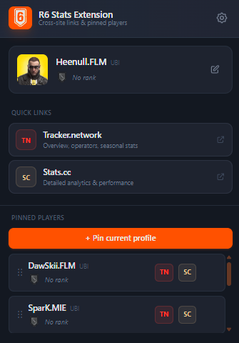
</p>

## Features

### Cross-site quick links

A "Tracker.gg" tab on stats.cc profiles, and a "Stats.cc" button on tracker.gg matches —
no more copy-pasting URLs between the two sites.

| stats.cc profile (Tracker.gg tab in nav) | tracker.gg match (Stats.cc button next to Share) |
|---|---|
| 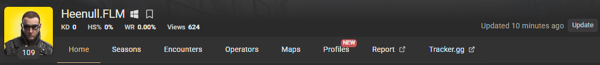 | 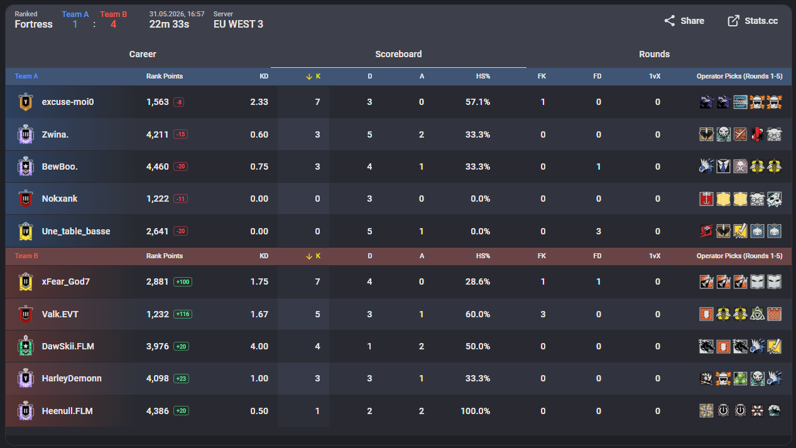 |

| tracker.gg profile (Stats.cc tab in nav) | stats.cc match (Tracker.gg tab in nav) |
|---|---|
| 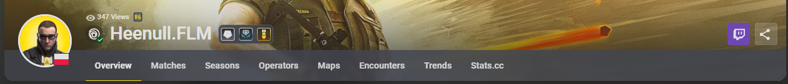 | 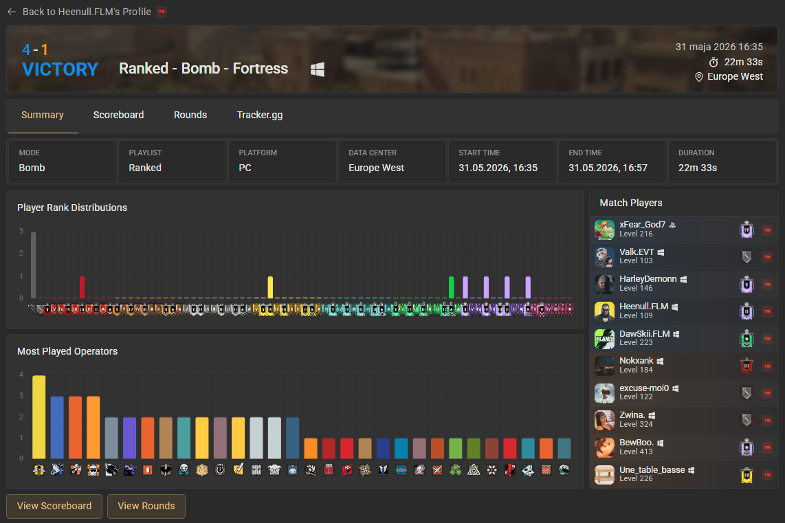 |

The popup also exposes per-player **TN** (Tracker.network) and **SC** (Stats.cc)
shortcuts in every pinned card, and per-player **TN** icons on every stats.cc scoreboard
and team list.

### Pinned players

Pin any tracker.gg or stats.cc profile and get **current-season rank + ranked K/D + RP**
shown right in the popup, with the proper rank icon. Auto-refresh in the background
runs on a configurable interval (default 3 h, minimum 30 min) and any visit to a pinned
player's tracker.gg profile triggers an immediate sync.

| First-time onboarding | Pinned list with ranks |
|---|---|
| 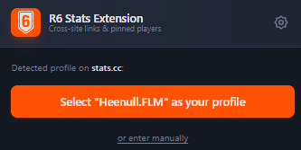 |  |

Rank extraction parses stats.cc's Nuxt SSR payload directly — what you see is the
*current* season's rank, not "top of all time".

### RP session summary on tracker.gg

On the `/matches` view of a tracker.gg profile, the extension injects a **per-day RP
balance** badge next to each day's header and a **session summary banner** spanning the
last five days. Auto-refreshes when you click "Load More".

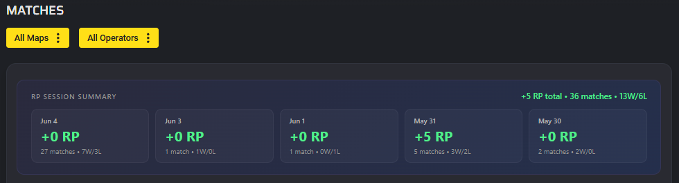

### Rank icon set

Three modes (popup → ⚙ Settings → "Rank icons"):

| Mode | What changes |
|---|---|
| **Default** | Each site's native artwork — we touch nothing |
| **New** | Force the new (post-rework) design everywhere; on stats.cc, swap legacy Champion icons to the bundled tracker.gg variant with the leaderboard rank baked in |
| **Old** | Force the old (pre-rework) design; tracker.gg Champion icons get a stats.cc-style minimalist composition with the top-X drawn over a clean shield |

Stats.cc, side by side:

| Default | New | Old |
|---|---|---|
| 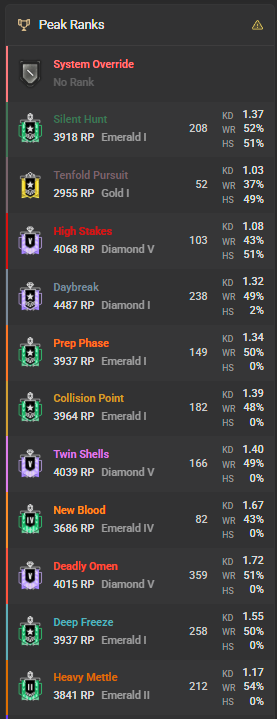 | 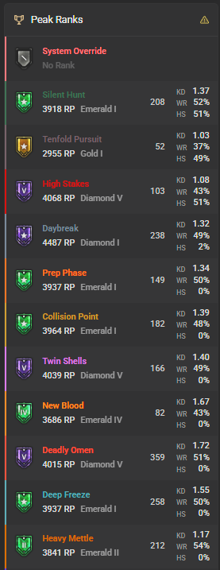 | 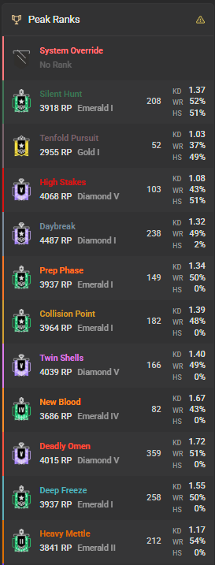 |

Tracker.gg, side by side (Default and New are identical because tracker.gg already
serves the new design natively):

| Default / New | Old |
|---|---|
| 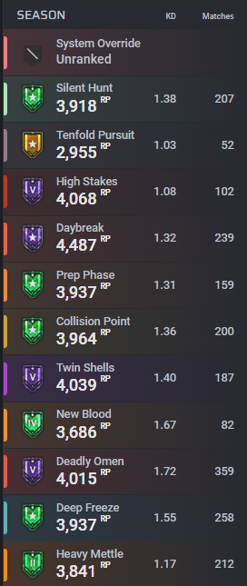 | 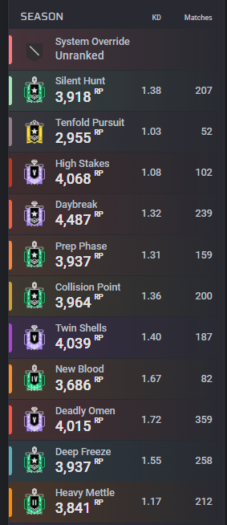 |

The chosen mode applies to both the popup AND every rank icon rendered on tracker.gg /
stats.cc pages — switching is instant, no re-fetch needed.

### Settings

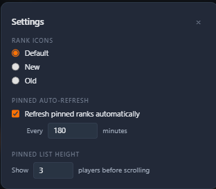

- **Rank icons** — Default / New / Old (above)
- **Pinned auto-refresh** — toggle + interval (≥ 30 min, default 180)
- **Pinned list height** — how many cards fit before the list scrolls (1–10)

### Smart link opening

When you click a link in the popup, the extension reuses the active tab if it's empty
(`about:blank` / new-tab page) and opens a new tab otherwise. No more littering the tab
bar when you click "Stats.cc" from a fresh window.

## Quick start

> Requires **Node.js 18+** and **npm**.

```bash
git clone https://github.com/Guliveer/r6-stats-extension.git
cd r6-stats-extension
./setup.sh        # macOS / Linux / WSL
:: setup.bat      # Windows
```

The setup script:
1. Installs npm dependencies
2. Generates extension icons (PNG/SVG) from the bundled R6 logo
3. Downloads bundled rank icons from stats.cc
4. Downloads & compresses all 9999 tracker.gg champion-rank icons (one-time, several
   minutes; ~50 MB on disk)
5. Builds the extension into `dist/`

Then load `dist/` as an unpacked extension:
1. Open `chrome://extensions/`
2. Enable **Developer mode** (top right)
3. Click **Load unpacked** and select the `dist/` folder

### Manual build

```bash
npm ci
node scripts/generate-icons.mjs           # extension icons (16/48/128 PNG + SVG)
node scripts/scrape-rank-icons.mjs        # tier rank icons
node scripts/scrape-champion-ranks.mjs    # ~9999 champion-rank PNGs
node scripts/convert-champion-ranks.mjs   # recompress to webp ~50 MB
npm run build
```

### From release

Pre-built `.zip`s are published at
[Releases](https://github.com/Guliveer/r6-stats-extension/releases) — download, unzip,
and load unpacked.

## Setup inside the extension

1. Click the extension icon (orange **R6** in the toolbar)
2. Visit your tracker.gg or stats.cc profile, then click **Select profile** in the popup
3. Or enter username / platform / GUID manually via the pencil button

> **Stats.cc requires the GUID.** Username is optional. Tracker.gg accepts either form.

## Tech notes

- **TypeScript** + **Vite** (build)
- **Tailwind CSS v4** (popup styling)
- **Chrome Manifest V3** (service worker, content scripts, alarms, storage)
- Rank data is parsed from `<script id="__NUXT_DATA__">` in stats.cc HTML — deterministic,
  no API guessing. URL conventions, DOM layouts, and per-site/per-mode swap rules are
  documented in [`docs/page-structure.md`](docs/page-structure.md).
- Champion top-X overlay on tracker.gg + Old uses an in-memory canvas composer
  (`src/lib/champion-overlay.ts`) onto the bundled `champion-small.webp`.

## License

[MIT](LICENSE)
